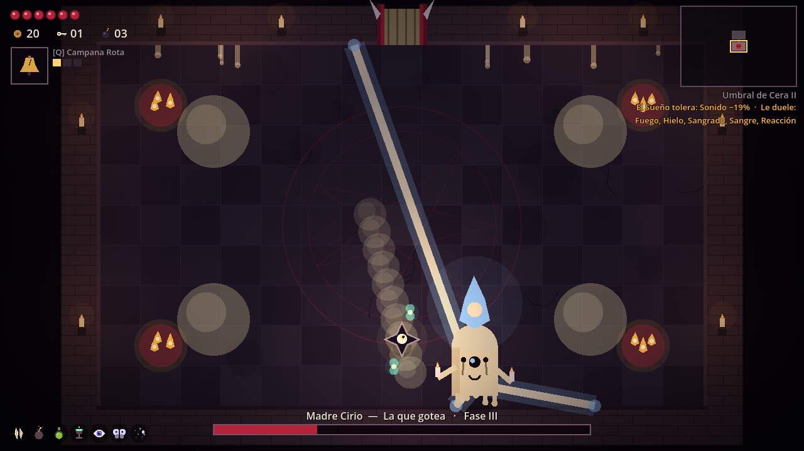

# VIGILIA — La Espina del Durmiente

Roguelite de acción 2D en Godot: construye sinergias mientras el sueño aprende de cómo luchas. Arte y audio generados por código, sin dependencias externas.

El proyecto está en [`vigilia/`](vigilia/). Importa [`vigilia/project.godot`](vigilia/project.godot) con **Godot 4.6.3** y pulsa **F5**.

- [Cómo jugar, controles y herramientas](vigilia/README.md)
- [Informe de pruebas de la versión actual](vigilia/docs/TEST_REPORT.md)
- [Diseño y próximos pasos](vigilia/docs/ROADMAP.md)

