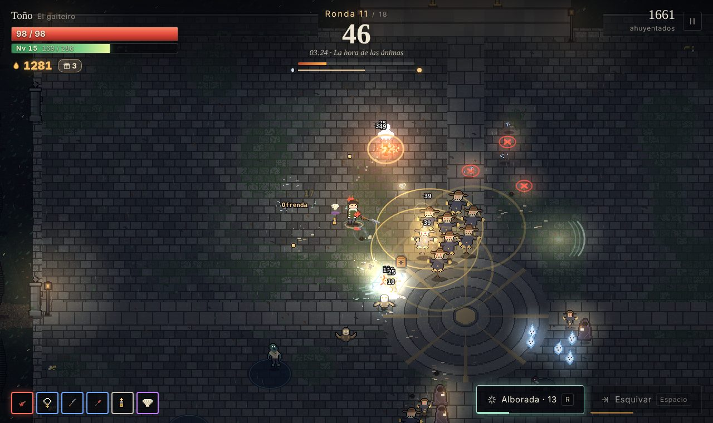
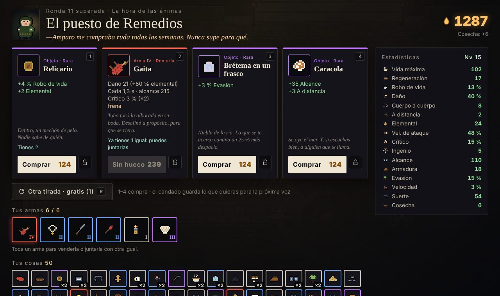

# La última vigilia

[](https://github.com/Big3ppvv/Vigilia/actions/workflows/verify.yml)

Ha muerto Amparo. Alguien tiene que velarla hasta que amanezca, porque esta noche la Santa Compaña hace la ronda.

Supervivencia por rondas para navegador: dieciocho rondas de medianoche a las seis, hasta seis armas que atacan solas alrededor de quien vela, recuerdos que mejoran tus estadísticas al subir de nivel y, entre ronda y ronda, el puesto de Remedios, la curandera, donde se compra, se guarda con candado, se vende y se juntan armas iguales. Sin dependencias: el arte, la música y el sonido se generan con código.


## Jugar

Descarga [`la-ultima-vigilia/la-ultima-vigilia.html`](la-ultima-vigilia/la-ultima-vigilia.html) y ábrelo con doble clic en un navegador moderno. Funciona sin conexión.

| Acción | Teclado | Táctil | Mando |
|---|---|---|---|
| Moverse | WASD o flechas | arrastra el dedo | palanca izquierda o cruceta |
| Esquivar | Espacio o Mayús | botón «Esquivar» | A |
| Habilidad | R (también E o Q) | botón de habilidad | X o B |
| Recordar / comprar | 1, 2, 3, 4 · R vuelve a tirar | toca la carta | — |
| Pausa | P o Esc | botón de pausa | Start |

## La noche, ronda a ronda

- **Rondas.** Dieciocho, tres por hora. La primera dura 20 segundos y cada una cinco más, hasta un minuto; la última, minuto y medio. Cada ronda empieza con la vida llena.
- **La cera.** La Compaña deja caer la cera de sus velas. Sirve a la vez de experiencia y de moneda. La que no recojas antes de que acabe la ronda se **funde**: en la ronda siguiente, cada gota que recojas trae una de más hasta que se acabe.
- **Recordar.** Cada nivel da +1 de vida máxima. Al acabar la ronda eliges un recuerdo de Amparo por cada nivel ganado: cuatro cartas, cada una mejora una de las 16 estadísticas con una rareza de I a IV.
- **El puesto de Remedios.** Cuatro ofertas entre armas y objetos. Puedes comprar, volver a tirar (cada vez cuesta más), guardar con candado para la próxima visita, vender armas y **juntar dos armas iguales** en una del siguiente nivel.
- **Armas.** Veinte, con cuatro niveles y seis clases (Labranza, Caza, Fuego, Sagrado, Mar, Romería). Llevar varias de la misma clase da un premio.
- **Objetos.** 69 remedios, amuletos, comidas de velatorio y cosas de Amparo. Casi todos dan algo y quitan algo; algunos cambian reglas: el toxo devuelve el daño, la medalla del Carmen te levanta, el faro de su padre barre el atrio.
- **Las criaturas.** Doce, cada una con su aviso: marcas en el suelo antes de aparecer, la banda roja de las embestidas, el círculo del rayo del nubeiro, las procesiones que cruzan el atrio. El trasno se come la cera del suelo; si lo atrapas, la suelta toda.
- **Difuntos con nombre** al final de cada hora y **la Guía** en la última ronda: hasta que no la liberes, el reloj de la torre no sigue.



## Seis personas que velan

| Personaje | Empieza con | Habilidad (R) |
|---|---|---|
| Lucía · la nieta | chispas, honda o navaja | **Lumbre:** fogonazo que aturde y hiere |
| Julián · el sepulturero | pala, escopeta de sal o forcado | **Cerco de sal:** frena y hiere durante unos segundos |
| Matilde · la rezadora | rosario, agua bendita o campanilla | **Responso:** cura un tercio y aparta |
| Toño · el gaiteiro | gaita, pandeireta o foguetes | **Alborada:** seis segundos de prisa |
| Sabela · la pescantina | remo, arpón o conchas de vieira | **Rede:** la red inmoviliza lo que atrapa |
| Don Anselmo · el párroco | botafumeiro, cirio pascual o campanilla | **Exorcismo:** acaba con lo que está casi deshecho |

Toño, Sabela y don Anselmo se desbloquean llegando a la ronda 6, a la ronda 12 y velando una noche entera. Cada victoria abre la siguiente de cuatro dificultades.



## Desarrollar

Requiere Node.js 22 o posterior; el servidor de desarrollo usa Python 3. Desde la raíz:

```sh
npm ci
npm run dev
```

Abre <http://localhost:8000>. Después de cambiar los módulos, `npm run build` regenera el HTML que se distribuye. `npm run check` comprueba sintaxis y que ese archivo esté actualizado.

Para ejecutar las pruebas:

```sh
npx playwright install chromium
npm test
```

Controles, parámetros de prueba y herramientas: [guía del juego](la-ultima-vigilia/README.md). Responsabilidades de cada sistema y cómo ampliarlo: [arquitectura](ARCHITECTURE.md). Identidad visual: [diseño](DESIGN.md).

## Cambiar el juego

- Texto (Amparo, quién la vela, criaturas, Remedios, finales): [`story.js`](la-ultima-vigilia/story.js).
- Números (rondas, criaturas, precios, rarezas, dificultad): [`balance.js`](la-ultima-vigilia/balance.js).
- Armas y clases: [`arsenal.js`](la-ultima-vigilia/arsenal.js). Objetos y recuerdos: [`items.js`](la-ultima-vigilia/items.js).


