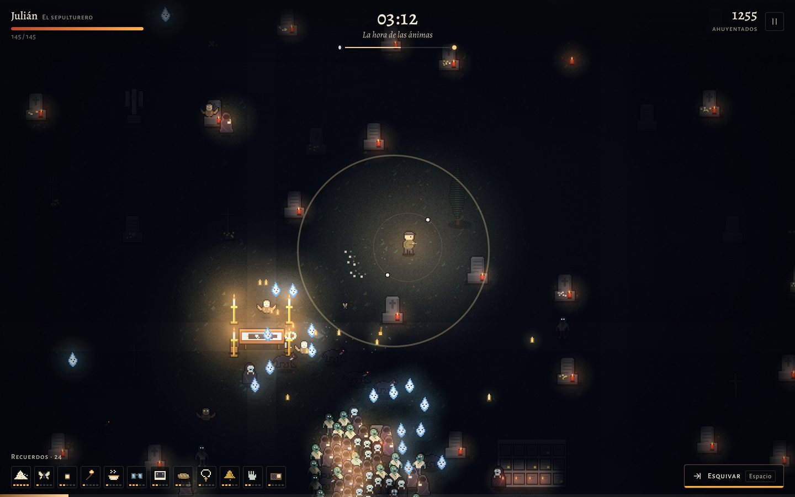
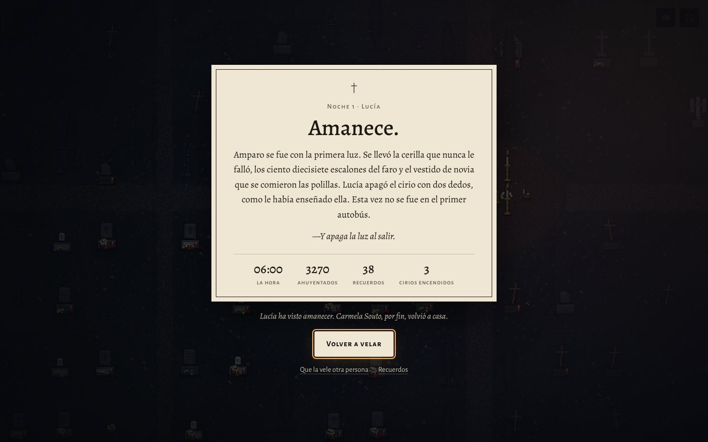

# La última vigilia

Ha muerto Amparo. Según la costumbre, alguien tiene que velarla hasta que amanezca para que la Santa Compaña no se la lleve. Esta noche te toca a ti.

Juego de supervivencia para navegador sobre una Noche de Difuntos, cuatro cirios y lo que se recuerda de quien se va. Diez minutos, de medianoche a las seis. Sin dependencias: el arte, la música y el sonido se generan con código.

## Jugar

Descarga [`la-ultima-vigilia/la-ultima-vigilia.html`](la-ultima-vigilia/la-ultima-vigilia.html) y ábrelo con doble clic en cualquier navegador moderno. Funciona sin conexión.

Se mueve con WASD o las flechas, se esquiva con Espacio y se arrulla con E; las armas atacan solas. En el móvil, arrastra el dedo sobre la pantalla. También se puede jugar con mando.

La Compaña viene en procesión a apagar los cirios del velatorio. Para encender uno basta con quedarse a su lado un momento. Si se apagan los cuatro, se llevan a Amparo.

## Cambiar la historia

Todo el texto (Amparo, quién la vela, sus recuerdos, lo que dice cada uno y los finales) está en [`la-ultima-vigilia/story.js`](la-ultima-vigilia/story.js), y todos los números, en [`la-ultima-vigilia/balance.js`](la-ultima-vigilia/balance.js). Después de editarlos, ejecuta `node build.mjs` dentro de `la-ultima-vigilia/` para regenerar el archivo que se juega.

Controles, lo que pasa cada hora, estructura del código y herramientas de prueba: [`la-ultima-vigilia/README.md`](la-ultima-vigilia/README.md).

