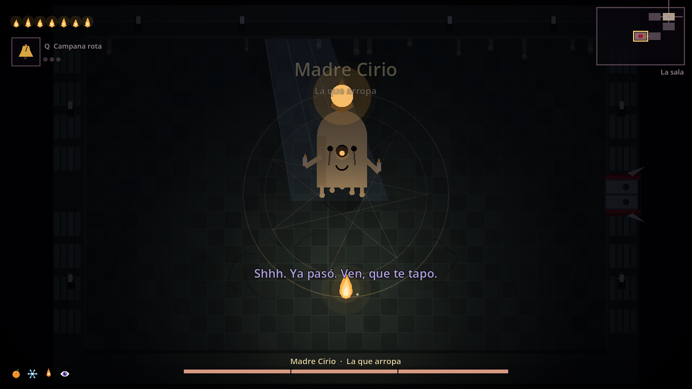

# VIGILIA — una vela encendida junto a la cama

Roguelite de acción 2D en Godot. Alguien te vela cada noche y deja una vela encendida en la mesita; dentro del sueño, tú eres esa llama. Tu vida es tu luz, las salas despiertan cuando enciendes sus velas y cada partida es una noche: si te apagas, te duermes; si llegas al final, despiertas. Arte, música y sonido generados por código.

El proyecto está en [`vigilia/`](vigilia/). Importa [`vigilia/project.godot`](vigilia/project.godot) con **Godot 4.6.3** y pulsa **F5**.

- [Cómo se juega y controles](vigilia/README.md)
- [Diseño: por qué se reestructuró](vigilia/docs/DESIGN.md)
- [Informe de pruebas de esta versión](vigilia/docs/TEST_REPORT.md)
- [Siguiente paso](vigilia/docs/ROADMAP.md)

