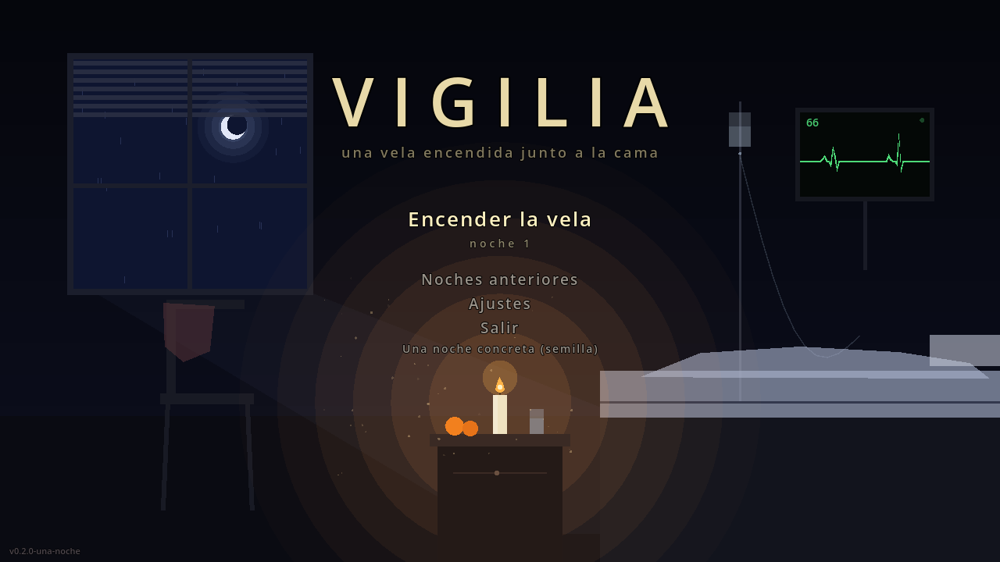
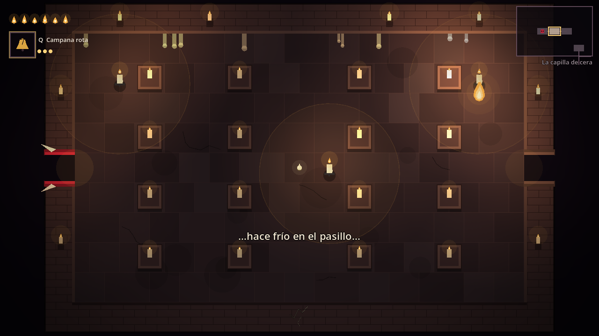

# VIGILIA — una vela encendida junto a la cama

Roguelite 2D de acción en **Godot 4** (GDScript). Hace mucho que no despiertas. Cada noche alguien se sienta junto a tu cama y deja una vela encendida en la mesita. Dentro del sueño, tú eres esa llama: lo único que sigue despierto. El sueño quiere que descanses. Para siempre.

**Cada partida es una noche.** Si te apagas, te duermes y mañana es otra noche. Si llegas al final, despiertas.



## Cómo se juega
- **Tu vida es tu llama.** Cuanta menos te queda, menos ves, más frío se vuelve el fuego y más fuerte canta el sueño para que te duermas.
- **Las salas están dormidas.** Cada una esconde velas apagadas: **quédate junto a una para encenderla**. Su luz debilita a las sombras y deshace los disparos que pasan junto a la llama. Si todas arden, la sala despierta y las sombras se deshacen. También puedes abatirlas a todas: es otra forma de ganar la sala, con otras recompensas.
- **Las polillas buscan la luz** y apagan las velas encendidas si las dejas.
- **Los objetos son recuerdos.** En los tesoros eliges uno de dos; en la Cabecera, la enfermera de noche te deja recordar a cambio de llama máxima.
- **El sueño aprende.** Si siempre luchas igual, en el piso siguiente las sombras lo resisten (y te lo dicen).
- **Esquiva rozando un disparo** para ganar Lucidez: críticos garantizados.



## Controles (remapeables en Ajustes → Controles)
| Acción | Teclado/ratón | Mando |
|---|---|---|
| Moverse | WASD | stick izquierdo |
| Apuntar y disparar | flechas, o ratón + clic izquierdo | stick derecho |
| Esquivar | Espacio | RB / A |
| Recordar (tomar un recuerdo) | E | X |
| Recuerdo activo | Q | Y |
| Recuerdos y mapa | Tab | Back |
| Pausa | Esc | Start |
| Pasar el texto / saltar la secuencia | cualquier tecla / Esc | — |
| Depuración / perfilador / piloto automático | F3 / F4 / F8 | — |

**Accesibilidad:** Ajustes → Vídeo regula la penumbra y la somnolencia (0 las desactiva); el alto contraste suaviza ambas; sin destellos, la luz no parpadea y la imagen no ondula. También hay escala de interfaz, sacudida de cámara regulable, números de daño opcionales y menos partículas.

## Requisitos
- **Godot 4.6.3** (el verificado y el que usa la CI).
- Sin dependencias, addons ni assets externos: arte, música y sonido se generan por código.

## Ejecutar
1. Abre la carpeta en el editor de Godot (Importar → `project.godot`) y pulsa **F5**.
2. O desde consola:
   ```bash
   godot --headless --path . --import
   ```
   ```bash
   godot --path .
   ```

Para generar ejecutables, instala las plantillas de exportación de Godot 4.6.3 y ejecuta:
```bash
godot --headless --path . --export-release "Windows" dist/windows/VIGILIA.exe
```
```bash
godot --headless --path . --export-release "Linux" dist/linux/VIGILIA.x86_64
```
Modo exhibición: `VIGILIA -- --demo [--seed=XXXX]` juega solo con el piloto automático.

## Pruebas y herramientas
```bash
tools/run_tests.sh            # 86 pruebas (headless, ~7 s)
```
```bash
tools/run_smoke.sh SEMILLA    # una noche completa con piloto automático (--god, --trace, --boss-only, --no-kindle)
```
```bash
tools/run_stress.sh           # estrés: 48 sombras / 2000 proyectiles
```
```bash
tools/screenshots.sh          # recorrido de capturas con render real (Xvfb si no hay pantalla)
```

## Documentación
- [`docs/DESIGN.md`](docs/DESIGN.md) — por qué se reestructuró, premisa, pilares, la decisión de cada sala.
- [`docs/ROADMAP.md`](docs/ROADMAP.md) — siguiente paso: jugarlo con personas, con protocolo y criterio de salida.
- [`docs/TEST_REPORT.md`](docs/TEST_REPORT.md) — pruebas, partidas con bot, equilibrio de las velas, estrés, verificación de la música.
- [`docs/ARCHITECTURE.md`](docs/ARCHITECTURE.md) · [`docs/CONTENT_GUIDE.md`](docs/CONTENT_GUIDE.md) · [`docs/SYNERGIES.md`](docs/SYNERGIES.md) · [`docs/KNOWN_ISSUES.md`](docs/KNOWN_ISSUES.md)

## Datos del jugador
Se guardan en `user://` (Linux: `~/.local/share/vigilia/`, Windows: `%APPDATA%\vigilia\`): `settings.cfg`, `profile.json` (noches, historial, descubrimientos) y sus copias `.bak`.
